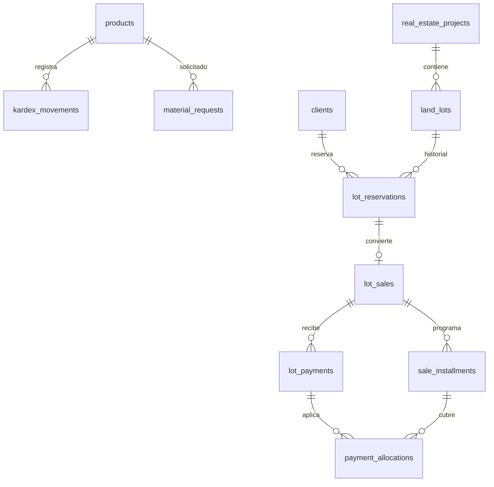

# Entrega técnica y recorrido de aceptación

## Alcance

El PDF GRUPO 04 define control local de almacén: catálogo, familias/unidades, entradas/salidas, stock, requerimientos, roles, alertas, reportes y documentación. La gestión comercial fue añadida por solicitud posterior del usuario: clientes, proyectos/lotes, reservas, venta interna, planes y cobros. No equivale a contabilidad, facturación electrónica, operación bancaria ni formalización de inmuebles.

## Entorno y datos

Laravel 13, PHP del contenedor 8.5, PostgreSQL 18 y Docker/WSL2. Los servicios son `laravel.test`, `pgsql` y `scheduler`. Adminer es opcional, limitado a localhost:8081. PostgreSQL conserva los datos en `sail-pgsql`; la configuración rápida conserva vendor en `sail-vendor`.

La aplicación usa las credenciales de .env. El nombre real de la base puede ser laravel o el que tenga configurado el usuario; no está fijado en los controladores. No se incluye .env en el paquete ni en Git.

## Reglas principales

- Stock: cantidades con hasta dos decimales según la unidad, registro de usuario y fecha, saldo no negativo y salida de requerimiento una sola vez. SKU generado bajo bloqueo de familia.
- Clientes: DNI de ocho dígitos como texto, sin duplicados; ingreso manual de identidad y contacto, sin consulta oficial.
- Reservas: un solo bloqueo activo por lote, vencimiento al finalizar el día en Perú, cancelación con motivo y constancia con datos históricos.
- Venta: solo desde reserva vigente; conserva precio/moneda y datos del acuerdo; una venta por lote y reserva. La conversión es transaccional e idempotente.
- Cuotas: inicial mínima del plan, importe repartido en céntimos y residuo en última cuota; anclaje mensual sin desbordar febrero u otros meses cortos. Condiciones guardadas por venta, sin recalcular contratos cuando se edita un plan.
- Pagos: no exceden saldo; referencias bancarias requeridas y control de duplicados. Se aplican primero a la inicial y a los vencimientos pendientes por orden.
- Cobro asistido: importe sugerido, fecha actual de Perú, varias cuotas o abono libre; el servidor comprueba saldo e importe revisados antes de confirmar. Un reenvío devuelve la operación ya registrada.
- Vencimientos: el servicio scheduler ejecuta el comando de reservas cada minuto mientras Docker funciona. Los estados de cuotas se calculan al consultar; no se generan intereses ni moras.
- Respaldo: el actualizador crea una copia SQL antes de migrar; nunca limpia la base. Las pruebas usan SQLite en memoria, con cachés separadas y guardia previa a preparar tablas.

## Permisos

| Función | Administrador | Operador |
|---|---|---|
| Catálogo, Kardex, reposición y reportes | Consulta y gestión autorizada | Consulta; registra movimientos |
| Requerimientos | Revisa, aprueba, rechaza y despacha | Solicita y consulta los propios |
| Productos, familias y unidades | Gestiona | Consulta |
| Proyectos y fichas de lotes | Gestiona | Consulta y reserva |
| Clientes y reservas | Registra y consulta | Registra y consulta |
| Cancelar reservas | Cualquiera | Solo las que registró |
| Planes y simulación | Configura y simula | Consulta y simula |
| Confirmar ventas y registrar pagos | Sí | Consulta el avance |
| Usuarios y reactivación | Gestiona | Perfil propio |
| Integridad de datos | Comprobación de solo lectura | Sin acceso |

## Prueba de presentación

1. Entrar con administrador. Mostrar productos por familias y unidades.
2. Crear un material, registrar entrada y salida; comprobar saldo y responsable. Intentar una salida mayor al disponible y verificar rechazo.
3. Entrar con operador. Crear requerimiento. Volver al administrador, aprobarlo y despacharlo; verificar que no se pueda repetir la entrega y abrir comprobante.
4. Registrar un cliente ficticio con DNI que empiece en 7. Desde su ficha reservar un lote disponible. Intentar reservar el mismo lote de nuevo y verificar rechazo.
5. Simular 24 meses con 10% inicial. Con administrador confirmar la compra y abrir cronograma.
6. Registrar inicial. Abrir de nuevo y comprobar que el importe sugerido sea la cuota siguiente. Adelantar varias cuotas, revisar reparto, confirmar y verificar saldo/historial.
7. Mostrar que un operador puede consultar y simular, pero no registrar un cobro ni administrar cuentas. La protección existe en rutas, no solo en los botones.
8. Filtrar el dashboard por semanas, meses y fechas, comprobar cuotas y reposición; descargar existencias y Kardex a Excel.
9. Abrir Guía de uso y comprobar integridad. Un dato previo sin Kardex puede necesitar conciliación; la herramienta no lo corrige automáticamente.

No se deben registrar pagos reales para una demostración. Usa datos ficticios y una copia de trabajo apropiada. Los datos de ejemplo de este proyecto no están validados en RENIEC ni SUNARP.

## Comprobaciones y límites

VERIFICACION.md contiene el estado real de pruebas. La revisión de integridad compara totales e identificadores, sin cambiar datos, y muestra como máximo 100 incidencias. No sustituye un arqueo, conteo físico o conciliación bancaria.

No se implementaron conexiones oficiales a RENIEC/SUNARP/SUNAT, SMTP externo, bancos, evaluación crediticia, intereses, moras, refinanciación, devoluciones ni anulación de ventas. Esas funciones necesitan requisitos y accesos adicionales. El registro comercial y sus documentos siguen siendo internos.
